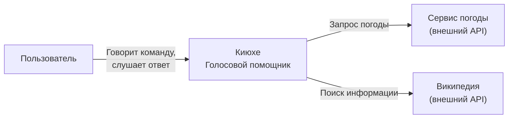
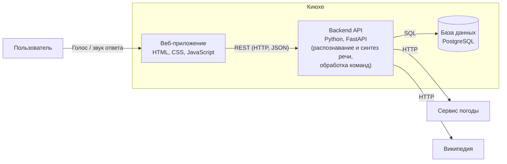

# Архитектура голосового помощника «Киюхе»

## C1 — System Context

### Описание
- **Система:** «Киюхе» — голосовой помощник. Принимает голосовую команду пользователя, распознаёт её, выполняет и отвечает голосом.
- **Пользователи:** обычные пользователи, которым удобнее управлять голосом (узнать погоду, найти информацию, поставить напоминание).
- **Внешние системы:**
  - Сервис погоды (например, OpenWeatherMap API) для запросов о погоде.
  - Википедия (API) для поиска справочной информации.

### Диаграмма

## C2 — Container

### Описание
- **Frontend:** веб-приложение (HTML, CSS, JavaScript). Работает в браузере, записывает голос с микрофона, отправляет его на сервер, затем воспроизводит голосовой ответ и показывает текст диалога.
- **Backend / API:** Python + FastAPI. Принимает аудио, распознаёт речь (Vosk или Whisper), определяет, чего хочет пользователь, выполняет команду (при необходимости обращается к внешним API), формирует ответ и превращает его в речь (Silero TTS).
- **База данных:** PostgreSQL. Хранит историю диалогов, напоминания и настройки пользователя.
- **Взаимодействие:**
  - Frontend ↔ Backend: REST API по HTTP (данные в формате JSON, аудио файлом).
  - Backend ↔ База данных: SQL-запросы.
  - Backend ↔ внешние сервисы: HTTP-запросы к их API.

### Диаграмма

### Как это работает (пример: «Какая погода в Москве?»)
1. Пользователь нажимает кнопку микрофона и говорит команду.
2. Веб-приложение записывает звук и отправляет его на Backend.
3. Backend переводит речь в текст (Vosk / Whisper).
4. Backend понимает, что это запрос погоды, и обращается к сервису погоды.
5. Backend формирует текстовый ответ и озвучивает его.
6. Backend сохраняет диалог в базу данных.
7. Веб-приложение получает ответ и проигрывает голос.
